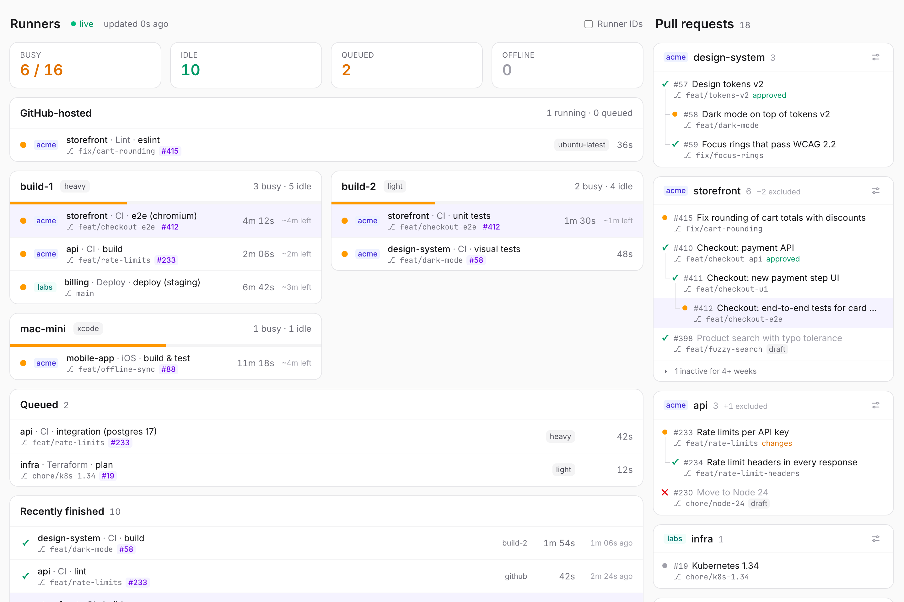

# runner-dashboard

A live view of your self-hosted GitHub Actions runners and the open pull
requests around them: which runner is busy with which job (repo, workflow,
job, branch, PR), what is queued, what finished recently, and which PRs are
open, stacked on top of each other, with their checks. Across several orgs,
updated within a second, in a single small container with no database.

<picture>
  <source media="(prefers-color-scheme: dark)" srcset=".github/screenshot-dark.png">
  
</picture>

- **Live by webhook.** Job and PR changes reach the browser within a
  fraction of a second to a few seconds of GitHub sending them.
- **Runners by host.** One card per machine, with its busy and idle
  runners and the job each one is running, plus an estimate of the time
  left from earlier runs of the same job.
- **Stacked PRs.** Open PRs per repo as trees: a PR whose base is another
  PR's branch sits on top of it. Hovering a PR highlights its jobs, and the
  other way round.
- **Cheap on API quota.** Runner lists are polled with ETags (unchanged
  answers are free) and only while someone has the page open.
- **Glanceable in a background tab.** The tab title shows "3/12 busy" and
  the favicon a colored dot: green when nothing waits, orange when jobs are
  queued, red when a runner is offline or an org has an error, grey when
  disconnected.
- **Small.** One Node process, no runtime dependencies.

It is read-only: it never starts, cancels or changes anything on GitHub.

```
     GitHub org webhooks (workflow jobs, pull requests, reviews, statuses, check suites)
                                   │ POST /api/webhook (signed)
browser ──SSE /api/events── server (Node 24) ──REST (ETag)── api.github.com
 Angular + Tailwind          jobs, PRs in memory              runner lists (polled)
                                              ──GraphQL──     bootstrap, reconcile
                                                              open pull requests
```

## Quick start

```bash
docker run --rm -p 8080:8080 \
  -e GITHUB_ORGS=my-org \
  -e GITHUB_TOKEN=github_pat_... \
  -e BASIC_AUTH_USERNAME=admin -e BASIC_AUTH_PASSWORD=change-me \
  ghcr.io/volkmann-design-code/runner-dashboard:latest
```

Open http://localhost:8080. Runners and running jobs show up right away,
pull requests within a minute; for live updates, add the webhook (below)
once the dashboard is reachable from the internet.

More complete setups: [`examples/docker-compose.yml`](examples/docker-compose.yml),
[`examples/kubernetes/`](examples/kubernetes/runner-dashboard.yaml).

## Setup

### 1. Token

One [fine-grained personal access token](https://github.com/settings/personal-access-tokens/new)
per org, read-only:

- **Resource owner:** the org
- **Repository access:** All repositories
- **Repository permissions** (all read-only):
  - *Actions*: workflow runs and jobs
  - *Pull requests*: the PR sidebar
  - *Contents*: a PR's last commit and the repo's default branch
  - *Commit statuses*: a PR's checks
  - *Metadata* (always on)
- **Organization permissions:** *Self-hosted runners*: Read-only

Orgs can require an owner to approve fine-grained tokens first. Without
*Contents* or *Commit statuses* the dashboard still runs; PRs then lack
checks (and stacks may treat `master` as a feature branch). A classic token
with `repo` and `admin:org` also works, but grants far more than needed.

### 2. Webhook (per org)

*Org settings → Webhooks → Add webhook*:

- **Payload URL:** `https://<your host>/api/webhook`
- **Content type:** `application/json`
- **Secret:** a random string (`openssl rand -hex 32`), the same as
  `GITHUB_WEBHOOK_SECRET` (or `GITHUB_WEBHOOK_SECRET_<ORG>`)
- **Events:** *Let me select individual events* → **Workflow jobs**,
  **Pull requests**, **Pull request reviews**, **Statuses** and
  **Check suites**

GitHub sends a `ping` right away; *Recent Deliveries* should show `200`.
After the first delivery, the footer shows "last webhook … ago". Without a
webhook the dashboard still works, but jobs only update every 5 minutes and
pull requests every minute while a tab is open.

### 3. Login

The page shows repository names, branches and PRs, private ones included,
so the server refuses to start without login. Either set
`BASIC_AUTH_USERNAME` and `BASIC_AUTH_PASSWORD`, or, if a proxy in front
already handles login (SSO, an auth middleware), set `ALLOW_ANONYMOUS=true`.
`/api/webhook` (signed by GitHub) and `/healthz` stay open either way.
Serve it over HTTPS.

## Configuration

| Variable | Default | |
|----------|---------|---|
| `GITHUB_ORGS` | *required* | Orgs to watch, comma-separated |
| `GITHUB_TOKEN_<ORG>` | | Token for one org, e.g. `GITHUB_TOKEN_MY_ORG` for `my-org` |
| `GITHUB_TOKEN` | | Fallback for orgs without their own token |
| `GITHUB_WEBHOOK_SECRET_<ORG>` | | Webhook secret for one org |
| `GITHUB_WEBHOOK_SECRET` | | Fallback; without any, nothing is pushed (see Webhook) |
| `BASIC_AUTH_USERNAME`, `BASIC_AUTH_PASSWORD` | | Login for the page |
| `ALLOW_ANONYMOUS` | `false` | `true` to run without login |
| `DASHBOARD_TITLE` | `Runners` | Page heading, tab title and login prompt |
| `ORG_LABELS` | org names | Short badge per org, e.g. `my-org=mine,other-org=oth` |
| `HOST_LABEL_PREFIX` | `host:` | See [Hosts](#hosts); empty to ignore labels |
| `RUNNER_NAME_PATTERN` | | See [Hosts](#hosts) |
| `HOST_NAMES` | | Display names for hosts, e.g. `srv-4711=build-1,srv-4712=build-2` |
| `POLL_INTERVAL_SECONDS` | `10` | Runner list, while a tab is visible |
| `PORT` | `8080` | |

`<ORG>` is the org name in upper case with every other character than
letters and digits replaced by `_`.

### Hosts

Runners are grouped into one card per host. The host of a runner comes
from, in this order:

1. **A label** `host:<name>` on the runner, e.g. register it with
   `--labels host:build-1`.
2. **Its name**, if `RUNNER_NAME_PATTERN` is set: a regular expression with
   a named group `host` and optionally `id` (shown when *Runner IDs* is on).
   For names like `acme-build-1-5lTdlxFIcI5r0` (prefix, host, random suffix):
   `^[^-]+-(?<host>.+)-(?<id>[^-]{6})[^-]*$`
3. Otherwise runners are grouped by org.

Labels that are not GitHub's defaults (`self-hosted`, OS, architecture)
show next to the host name, e.g. `gpu` or `large`. Idle runners are only
counted in the card header; busy and offline ones get a row.

When more than one org is watched, runners, jobs and repos carry a colored
org badge (`ORG_LABELS`).

### In the browser

Some settings belong to whoever looks, so they live in the browser
(`localStorage`), not in the server's configuration:

- *Runner IDs* in the header.
- Per repo in the PR sidebar, behind the slider icon (violet when changed;
  only what differs from the defaults is stored):
  - *Fold PRs inactive for* 1–10 weeks (default 4) or never: stacks
    without a commit, comment or review for that long fold into a
    collapsed section at the end of the repo.
  - *Exclude authors*: the repo's PR authors; bots (Renovate, Dependabot,
    …) are excluded by default, new bots too, until shown.
  - *Hide repo*, *Reset to defaults*.

## How it works

- **Jobs come by webhook.** Each org sends `workflow_job` events (queued,
  in progress, completed). The server checks the signature, stores the job
  and pushes the change to open browsers. The payload has no PR number, so
  the job's workflow run is fetched once per run. Jobs on GitHub's own
  runners (no `self-hosted` in `runs-on`) are shown in a card of their own.
- **Runners are polled.** GitHub has no webhook for runners going online,
  offline or busy, so each org's runner list is polled every 10 s while a
  tab is visible, every 60 s while only hidden tabs are open, and not at
  all without any tab.
- **Bootstrap.** Webhooks only report changes, so on startup the server
  reads the recent workflow runs of every repo once to find jobs that are
  already queued or running.
- **Reconcile.** A job without news for 5 minutes is re-read from the API,
  in case a delivery was missed. Jobs GitHub no longer knows are dropped.
- **Order.** GitHub does not guarantee delivery order, so a job never moves
  back (an `in_progress` arriving after `completed` is ignored).
- **Runner ↔ job:** a busy runner's job is the in-progress job whose
  `runner_name` matches.
- **Time left** for a running job is estimated in the browser: the median
  of the last 10 successful runs of the same job, learnt from the "Recently
  finished" list and kept in `localStorage`. No history, no estimate.
- **Pull requests** are read via GraphQL: all open PRs of each org at
  startup (25 per page; GitHub's GraphQL gives up after about 10 s, and its
  search is slow, so a few hundred PRs take about a minute). A
  `pull_request`, `pull_request_review`, `status` or `check_suite`
  delivery, or a finished job of a PR, re-reads that repo's open PRs a
  couple of seconds later. While a tab is open, each org is re-read every
  5 minutes as well, for missed deliveries. PRs go to the browser as their
  own event, only when they change.
- **Stacks** are built in the browser: a PR whose base is another open
  PR's branch sits on top of it. A PR whose base is neither the default
  branch nor an open PR's branch is marked "→ base" (usually its parent was
  merged without deleting the branch, so GitHub did not retarget it). The
  status icon is a dot while a job of the PR runs (pulsing) or waits,
  otherwise the PR's combined checks. A PR's activity is its last commit,
  comment or review, not GitHub's `updatedAt`, which bulk changes to a repo
  bump on every open PR.

Everything lives in memory, so run exactly one instance; a restart costs
one bootstrap and one PR read.

**API cost** per org: on startup about two REST requests per repo; with a
visible tab at most 360 runner-list requests per hour, mostly free `304`s;
one request per new workflow run; a few for reconcile. Pull requests use
GraphQL's separate budget: about 3 points per 100 PRs per read. The footer
shows the remaining REST quota and the last webhook per org.

**Limits:** github.com orgs only (no personal accounts, repo-level runners,
enterprise runners or GitHub Enterprise Server yet). Up to 100 runners per
org.

## Development

Node 24 or newer.

```bash
npm ci
npm run build
GITHUB_ORGS=my-org GITHUB_TOKEN=$(gh auth token) ALLOW_ANONYMOUS=true npm run server
# → http://localhost:8080
```

A `gh` token needs the `admin:org` scope to list org runners
(`gh auth refresh -s admin:org`). For live reload of the UI, also run
`npm start` and open http://localhost:4200 (it proxies `/api` to `:8080`).

GitHub's webhooks cannot reach localhost, so locally jobs come from the
bootstrap and then only change via reconcile, and PRs are re-read every
minute. To try the webhook path, set `GITHUB_WEBHOOK_SECRET=<anything>` and
POST a payload signed with it (`X-Hub-Signature-256`), as
`server/http/routes.test.ts` does.

```bash
npm run check:server   # type check the server
npm test               # node --test (server and the browser's pure logic)
```

| Path | |
|------|---|
| `shared/snapshot.ts` | The contract: what `/api/events` streams |
| `server/main.ts` | Wiring and startup |
| `server/config.ts` | Environment variables |
| `server/org.ts` | One watched org: API client, webhook secret, status |
| `server/github/` | REST and GraphQL client (ETag cache), response and webhook types, signature check |
| `server/jobs/` | Job store, bootstrap, reconcile, run details (PR) |
| `server/runners/` | Runner list polling, host detection |
| `server/pulls/` | Open pull requests: GraphQL queries, refresh by webhook and fallback poll |
| `server/mapping.ts` | GitHub shapes → snapshot shapes |
| `server/build-snapshot.ts` | Runners + jobs + org status → snapshot |
| `server/snapshot-stream.ts` | SSE subscribers, publishing, runner poll loop |
| `server/http/` | Routes, Basic Auth, webhook endpoint, static files |
| `src/app/core/` | Snapshot stream as signals, tab title and favicon, preferences, org badges, job durations |
| `src/app/hosts/` | Host cards, runner rows, GitHub-hosted card |
| `src/app/jobs/` | Job lists, the two-line job summary |
| `src/app/pulls/` | PR sidebar: per-repo view and settings, stack building, PR rows |

Node runs the server's TypeScript directly (type stripping), so there is no
server build step.

The README's screenshots show the real UI with made-up data
(`.github/screenshot/data.mjs`), rendered the same on every run (frozen
clock, pinned Chromium and fonts):

```bash
npm run build
cd .github/screenshot && npm ci && npx playwright install chromium && npm run screenshot
```

## Releasing

Bump `version` in `package.json`, merge, then tag:
`git tag v0.6.1 && git push origin v0.6.1`. The release workflow publishes
`ghcr.io/volkmann-design-code/runner-dashboard` for amd64 and arm64.

## Contributing

Issues and pull requests are welcome. Please run `npm test` and
`npm run check:server` before opening a PR. For security issues, see
[SECURITY.md](SECURITY.md).

## License

[MIT](LICENSE)
